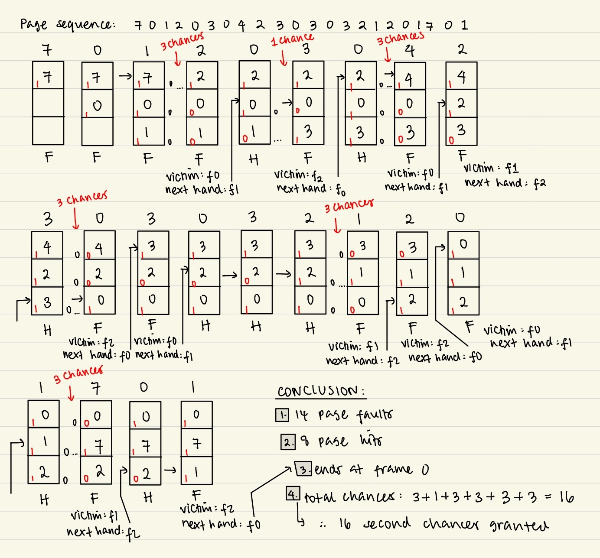

## Programming Assignment 3 Type 3
Page replacement: Second Chance algorithm<br>
Authored by: Alyssa Rahma Adjani & Paramita Santoso

### Member contributions
| Member | Student ID | Contribution |
| --- | --- | --- |
| Alyssa Rahma Adjani | 2506558466 | - completed `vmsim.c`<br>- made presentation slides<br>- manual verification |
| Paramita Santoso | 2506554171 | - authored `explanation.md`<br>- captured outputs|
<br><br>

### Questions & Answers

#### VmRSS barely moves when the program asks for 3.81 MiB, then jumps by roughly that much once every element has been written. Why?
> Name the mechanism and the lecture slide, and quote your own two VmRSS figures.
<br>

VmRSS (Resident Set Size) is the actual physical RAM allocated to the process. When requesting 3.81 MiB (4,000,000 bytes), VmRSS barely changed (moving from 1884 KiB to 1888 KiB for malloc, and remaining at 1884 KiB for mmap). It only jumped to 5792 KiB (+3908 KiB) after writing to every element. <br>

The mechanism is **Demand Paging** (lecture slide 37). In this experiment, malloc or mmap makes virtual memory available without immediately allocating physical frames for the whole block. malloc may reuse memory already managed by the allocator instead of creating a new kernel mapping. Valid virtual addresses can have pages that are not yet resident. Physical RAM for the block is allocated lazily page-by-page as writes trigger page faults; faults can also occur on reads or later accesses to nonresident pages.   

#### How many bytes were wasted in the last page, and why can that waste never be avoided?
> What is this kind of waste called, and how does it differ from the other kind on the same slide?
<br>

1,792 bytes were wasted in the last page. Memory is handed out in whole pages of 4096 bytes, so 4,000,000 bytes needs ⌈4,000,000 / 4096⌉ = 977 pages = 4,001,792 bytes. A page cannot be split, so the unused 4,001,792 − 4,000,000 = 1,792 bytes stay in the last page. The only way to avoid it would be a request that is an exact multiple of 4096. 
<br><br>
This waste is called Internal Fragmentation (wasted space inside an allocated frame). It differs from External Fragmentation, when the total free memory is enough for a request, but it is scattered in pieces too small to use as one contiguous block. Paging has no external fragmentation, because any free frame can hold any page. It pays with internal fragmentation instead, which is at most (one page size - 1) per allocation.

#### Compare the page offset printed for the first byte of the malloc block with the one printed for the mmap block.
> One is 0 and the other is not. Which is which, and what does the difference tell you about who is managing those bytes? Quote your own two numbers.
<br>

- mmap first byte offset: 0 (address 0x72e2b262f000)   
- malloc first byte offset: 16 (address 0x72e2b262f010)   

<br>
Management Difference: mmap is managed directly by the Linux OS kernel, returning memory starting exactly at a 4096-byte page boundary (offset 0). malloc is managed by the C standard library allocator (glibc), which in this experiment places a 16-byte header (storing allocation size and control flags) immediately before the returned address.   

#### The statically linked binary is far larger than the dynamically linked one, and ldd reports no shared libraries for it.
> Quote both sizes from your own make sizes output, explain both facts, and give one advantage of each kind of linking.
<br>

Dynamic binary (`memlab`): 17K   
Static binary (`memlab-static`): 976K   
The static binary is larger because the linker copies the C library code it needs (libc) into the executable.
`ldd` prints "not a dynamic executable" for `memlab-static` since the required C library code (libc) is linked directly into the binary image and no shared libraries need to be loaded at run time.
<br><br>
**Static Linking Advantage**: Portability and self-sufficiency; runs without requiring external shared library dependencies on the host system.   
**Dynamic Linking Advantage**: Storage and memory efficiency; reduces executable binary size and allows multiple running programs to share a single copy of libc.so.6 in physical RAM.

---
### How the algorithm works

#### Code snippet in `vmsim.c`
```c
static int hand_from[MAX_REFS];
static int chances_at[MAX_REFS];
int choose_victim(VmSim *sim)
{   
    int starting_hand = sim->hand;
    int chances = 0;

    while (1) {
        if (sim->frame[sim->hand].ref_bit == 0) {
            int victim = sim->hand;
            sim->hand = (sim->hand + 1) % sim->nframes;
            
            if (sim->recording) {
                hand_from[sim->t] = starting_hand;
                chances_at[sim->t] = chances;
            }

            return victim;
        } else {
            sim->frame[sim->hand].ref_bit = 0;
            sim->hand = (sim->hand + 1) % sim->nframes;
            
            chances++;
        }
    }
}
```
(The `if (sim->recording)` block only saves data for `print_topic_extra()`. The decision itself is the if/else.)

#### Second Chance

Second Chance is FIFO with a reprieve. The frames form a circular queue and the pointer (`sim->hand`) points to the next candidate for replacement in circular order, which is not necessarily the page loaded earliest. The library sets a frame's ref_bit to 1 whenever its page is loaded or referenced.<br>
Reference bit:
- 0: The page has not been accessed since the bit was last cleared.
- 1: The page has been loaded or accessed since the bit was last cleared.<br>

#### Code explanation

When a new page is coming and page fault occurs,<br>
- If the frame under the hand has `ref_bit == 0`, it is the victim. The hand moves past it before returning, so the next eviction starts at the next frame.
- If `ref_bit == 1`, the page gets its Second Chance: the bit is cleared, the hand moves on, and the page stays. It is selected for eviction if the hand reaches it again while its bit is still 0.

Why it always terminates: every frame the hand passes has its bit cleared. After at most one full lap (nframes steps) every bit is 0, so the next frame the hand reaches is taken. No safety counter is needed. Tie-break: the hand position decides, so the order is deterministic and identical on every run.

---
### Results and comparation

#### Fault counts (required test runs)

| String | Frames | FIFO | Second Chance | Diff | Chances granted |
|---|---|---|---|---|---|
| r1-lecture | 3 | 15 | **14** | −1 | 16 |
| r2-belady | 3 | 9 | 9 | 0 | 9 |
| r3 | 3 | 10 | **9** | −1 | 10 |
| r4 | 3 | 11 | 11 | 0 | 12 |
| r5 | 3 | 12 | 12 | 0 | 11 |
| r6 | 3 | 15 | 15 | 0 | 12 |
| r7-reuse | 4 | 6 | 6 | 0 | 4 |

#### Frame sweep, 1 to 7 frames (FIFO / Second Chance)

| String | 1 | 2 | 3 | 4 | 5 | 6 | 7 |
|---|---|---|---|---|---|---|---|
| r1 | 22/22 | 15/15 | 15/**14** | 10/**9** | 9/9 | 6/6 | 6/6 |
| r2 | 12/12 | 12/12 | 9/9 | 10*/10* | 5/5 | 5/5 | 5/5 |
| r3 | 13/13 | 11/11 | 10/**9** | 7/**6** | 6/6 | 6/6 | 6/6 |
| r4 | 14/14 | 13/13 | 11/11 | 11/**10** | 10/10 | 7/7 | 7/7 |
| r5 | 13/13 | 13/13 | 12/12 | 10/10 | 10/10 | 9/9 | 7/7 |
| r6 | 15/15 | 15/15 | 15/15 | 9/**10** | 6/6 | 6/6 | 6/6 |
| r7 | 15/15 | 9/9 | 9/9 | 6/6 | 5/5 | 5/5 | 5/5 |

`*` = marks a frame count where adding a frame made things worse (Belady's anomaly). Over all 49 (string, frame count) pairs, Second Chance is better in 5, worse in 1 (r6 at 4 frames) and identical in 43.

#### Comparison against FIFO
What Second Chance does better and why?
- Second Chance algorithm may result in fewer page faults than basic FIFO because it considers recent usage rather than blindly evicting the oldest page in memory.
- On the lecture string with 3 frames, Second Chance took 14 faults against FIFO's 15 and LRU's 12, landing between the two as intended. It also beat FIFO on r3 (10 → 9) and at 4 frames on r1 (10 → 9), r3 (7 → 6) and r4 (11 → 10).
- The mechanism is visible at t=5 on r1. Page 0 was loaded at t=1 and hit at t=4, so its reference bit was 1. FIFO evicts page 0 because it is the oldest, and then faults on it at t=6. Second Chance reaches page 0's frame (f1), sees the bit, clears it and passes over it (chances = 1, victim f2, page 1). Page 0 survives and the hit at t=6 is kept. In other words, the bit lets recent use override pure load order, which is the one thing FIFO cannot do.

What it does worse or what it costs?
- Hardware/Bit Overhead: requires maintaining and checking an additional reference bit for each page.
- Time/CPU Overhead: When a page fault occurs, Second Chance may have to inspect and traverse multiple pages in the queue (clearing reference bits from 1 to 0 and rotating them to the back) before finding a page with a reference bit of 0.

Which reference string shows the biggest difference?
- At 3 frames, **r1 and r3 tie** for the largest improvement at one fewer fault, while **r3** has the larger percentage improvement: 10 → 9 (−10.0%, bigger than r1's −6.7%). r3 also improves from 7 → 6 at 4 frames. r3 has the same pattern as r1 (a page such as 0 used again just before FIFO would evict it). It shows the algorithm at its best: pages can survive when the hand reaches them with their bit set, and a re-reference after the bit is cleared sets it back to 1. The largest *negative* difference is r6 at 4 frames (+1).


### Belady's Anomaly

```
  r2-belady.txt
===========================================================
  algorithm : Second Chance
-----------------------------------------------------------
  frames         FIFO          yours   difference
-----------------------------------------------------------
  1               12             12            +0
  2               12             12            +0
  3                9              9            +0
  4               10*            10*           +0
  5                5              5            +0
  6                5              5            +0
  7                5              5            +0
-----------------------------------------------------------
  * marks a frame count where ADDING a frame made things worse.
    That is Belady's anomaly (lecture slide 46).

  FIFO on this string            : ANOMALOUS, more frames cost more faults
  Your algorithm on this string  : ANOMALOUS, more frames cost more faults
===========================================================
```

The frame sweep shows the anomaly on **r2-belady.txt at 4 frames**: both FIFO and Second Chance go from 9 faults at 3 frames to **10** at 4 frames (marked `*`).  
On the other six strings (r1, r3, r4, r5, r6, r7) neither algorithm showed the anomaly. That only means **it did not happen on these strings**. It does not mean it cannot happen. **Optimal and LRU** can claim "cannot happen", because they are stack algorithms: the pages held with *n* frames are always a subset of those held with *n*+1. FIFO and Second Chance are not stack algorithms, and for Second Chance the r2 result shows it can actually happen.


### EAT and Fault Rate
The program prints EAT for every run, with memory access = 100 ns and fault service = 8 ms:

EAT = (1 − p) × 100 ns + p × 8,000,000 ns

| String | Frames | Faults / Refs | p | EAT (ns) | Slowdown |
|---|---|---|---|---|---|
| r1 | 3 | 14/22 | 0.6364 | 5,090,945.5 | 50,909.5× |
| r2 | 3 | 9/12 | 0.7500 | 6,000,025.0 | 60,000.2× |
| r3 | 3 | 9/13 | 0.6923 | 5,538,492.3 | 55,384.9× |
| r4 | 3 | 11/14 | 0.7857 | 6,285,735.7 | 62,857.4× |
| r5 | 3 | 12/13 | 0.9231 | 7,384,623.1 | 73,846.2× |
| r6 | 3 | 15/15 | 1.0000 | 8,000,000.0 | 80,000.0× |
| r7 | 4 | 6/15 | 0.4000 | 3,200,060.0 | 32,000.6× |

EAT is almost entirely `p × 8 ms`, because a fault is 80,000 times slower than a memory access. To stay within a 10% slowdown (EAT < 110 ns): 100 + p × 7,999,900 < 110, so fault rate **p < 0.00000125**, about **1 in 799,990 references**. Our fault rates of 40% to 100% are far from that. They are so high because these are tiny cold-start strings with only 3 to 4 frames, where first touches cause compulsory faults and limited frame capacity causes repeated faults when evicted pages are needed again. A real system reaches 1 fault in hundreds of thousands of references only through locality of reference and enough frames for the working set.

### Manual verification: `r1-lecture.txt`

We manually traced Second Chance using three frames and the reference string:

```text
7 0 1 2 0 3 0 4 2 3 0 3 0 3 2 1 2 0 1 7 0 1
```



Rules used:

- A page loaded on a fault gets `ref_bit = 1`, and a hit sets `ref_bit = 1`. This follows the simulator (`vmlib.c`) and the assignment's expected output. Some textbooks load with 0, which would give a different result (11 faults on this string), so we followed the simulator's convention.
- When the hand finds a frame with `ref_bit = 1`, it clears the bit (a second chance) and moves on.
- It takes the first frame whose bit is 0, then moves the hand past it.
- Free frames are filled without calling `choose_victim()`, so the hand stays at f0.

The iterations below show the first ten references, as required. Frame contents and reference bits are shown **after** each request.

```
ref 7 : fault, frame 0 free      frames: 7 . .    bits: 1 . .
ref 0 : fault, frame 1 free      frames: 7 0 .    bits: 1 1 .
ref 1 : fault, frame 2 free      frames: 7 0 1    bits: 1 1 1
ref 2 : fault, memory full, hand at f0: f0, f1, f2 all have bit 1, so all are cleared
        (3 chances); hand wraps to f0 (bit 0), so victim = f0, hand -> f1
                                 frames: 2 0 1    bits: 1 0 0
ref 0 : hit, frame 1             frames: 2 0 1    bits: 1 1 0
ref 3 : fault, memory full, hand at f1: f1 has bit 1, so it is cleared (1 chance);
        f2 has bit 0, so victim = f2, hand -> f0
                                 frames: 2 0 3    bits: 1 0 1
ref 0 : hit, frame 1             frames: 2 0 3    bits: 1 1 1
ref 4 : fault, memory full, hand at f0: f0, f1, f2 all have bit 1, so all are cleared
        (3 chances); hand wraps to f0 (bit 0), so victim = f0, hand -> f1
                                 frames: 4 0 3    bits: 1 0 0
ref 2 : fault, memory full, hand at f1: f1 has bit 0, so victim = f1
        (0 chances), hand -> f2
                                 frames: 4 2 3    bits: 1 1 0
ref 3 : hit, frame 2             frames: 4 2 3    bits: 1 1 1
```

The table below has two columns for the hand:

- **Hand from**: where the hand was when the fault happened, which is where the search for a victim starts. It is only filled for faults with memory full, because free frames are filled without moving the hand. This is the same as "hand from" in the program's Second Chances table.
- **Hand after**: where the hand is once the request is finished, which is also where the next replacement search will start.

| t | Ref | Result | Hand from | Chances | Victim | Frames `[f0 f1 f2]` | Ref bits | Hand after |
|---:|---:|---|---|---:|---|---|---|---|
| 0 | 7 | fault, frame 0 free | – | 0 | – | `7 . .` | `1 . .` | f0 |
| 1 | 0 | fault, frame 1 free | – | 0 | – | `7 0 .` | `1 1 .` | f0 |
| 2 | 1 | fault, frame 2 free | – | 0 | – | `7 0 1` | `1 1 1` | f0 |
| 3 | 2 | fault, memory full | f0 | 3 | f0 | `2 0 1` | `1 0 0` | f1 |
| 4 | 0 | hit, frame 1 | – | 0 | – | `2 0 1` | `1 1 0` | f1 |
| 5 | 3 | fault, memory full | f1 | 1 | f2 | `2 0 3` | `1 0 1` | f0 |
| 6 | 0 | hit, frame 1 | – | 0 | – | `2 0 3` | `1 1 1` | f0 |
| 7 | 4 | fault, memory full | f0 | 3 | f0 | `4 0 3` | `1 0 0` | f1 |
| 8 | 2 | fault, memory full | f1 | 0 | f1 | `4 2 3` | `1 1 0` | f2 |
| 9 | 3 | hit, frame 2 | – | 0 | – | `4 2 3` | `1 1 1` | f2 |

For example, at `t = 3`, all three reference bits are 1. The hand clears each bit during one complete lap, granting three second chances. It then returns to f0, whose bit is now 0, and replaces page 7 with page 2.

At `t = 5`, the hand starts at f1. Page 0 has bit 1 because it was accessed at `t = 4`, so it receives a second chance. The hand then selects f2, which holds page 1 with bit 0. Page 0 remains in memory, allowing the request at `t = 6` to be a hit.

We continued the manual trace through all 22 references and obtained:

| Measurement | Manual result |
|---|---:|
| Page faults | 14 |
| Page hits | 8 |
| Evictions | 11 |
| Second chances granted | 16 |
| Final hand position | f0 |
| Final frame contents | `[0, 7, 1]` |

The second-chance counts across the eleven evictions are:

```text
3 + 1 + 3 + 0 + 3 + 0 + 3 + 0 + 0 + 3 + 0 = 16
```

**Comparison with the program.** These hand results match the `-v` trace and the
"Second Chances Granted" table printed by `./vmsim refs/r1-lecture.txt`.
For t = 3, 5, 7 and 8 the hand starts at f0, f1, f0, f1, the chances are 3, 1, 3, 0,
and the victims are f0, f2, f0, f1, the same as in the program output.